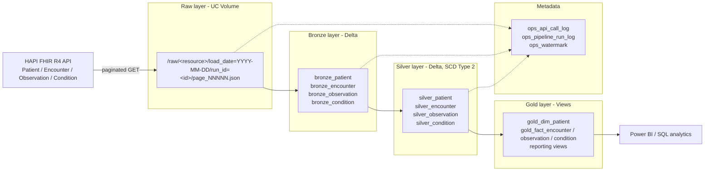
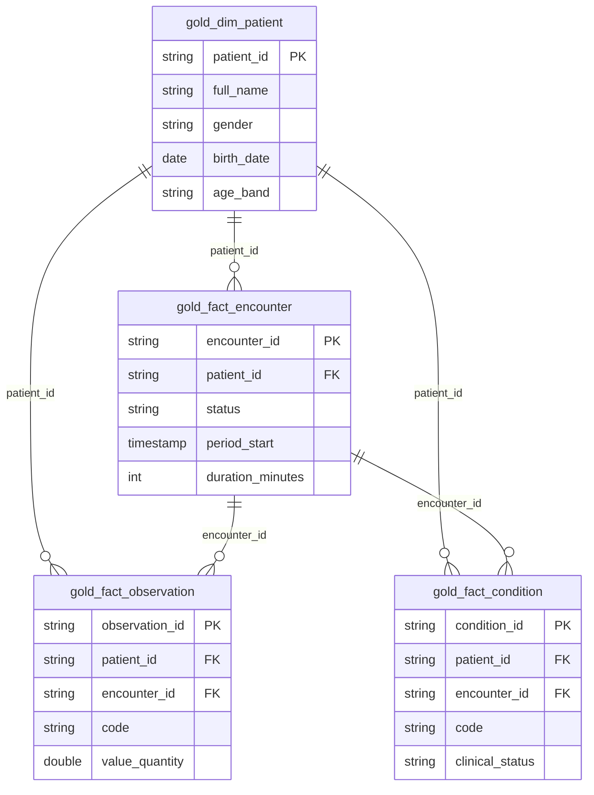
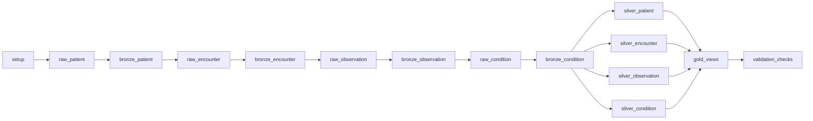

# FHIR API Data Ingestion & Analytics - Solution Document

| Item | Value |
| --- | --- |
| Platform | Databricks (Unity Catalog, Delta Lake, serverless compute, Lakeflow Jobs) |
| Source | HAPI FHIR R4 public API - `https://hapi.fhir.org/baseR4` |
| Resources | Patient, Encounter, Observation, Condition |
| Target location | Catalog `fhirapidata1_ws`, schema `fhir_lakehouse`, volume `raw` |
| Orchestration | Lakeflow Job "FHIR Medallion Lakehouse Pipeline" |
| Data loaded | 3 days (2026-11-07 to 2026-11-09, UTC), paginated |

---

## 1. Objective

Build an incremental ingestion pipeline for the FHIR API and model the data using a Medallion Lakehouse architecture (Raw -> Bronze -> Silver -> Gold), with ingestion metadata on every table, data versioning (SCD Type 2), and an orchestrated pipeline that calls the APIs in the order Patient -> Encounter -> Observation -> Condition.

## 2. Requirement traceability

| # | Requirement (assignment) | Implementation | Where |
| --- | --- | --- | --- |
| 1 | Ingest Patient, Encounter, Observation, Condition | One generic ingestion notebook parameterised by `resource` | `02_raw_ingest_api` |
| 2 | Fetch incrementally for 2-3 days using pagination | UTC day buckets via `_lastUpdated`, `_count` page size, follow `Bundle.link[next]`; raw watermark per resource | `02_raw_ingest_api`, `ops_watermark` |
| 3 | Store JSON response as it is | Response bytes written unchanged, one file per page | Raw volume |
| 4 | Convert JSON to Delta | Bundle exploded to one row per resource, stored as Delta | `03_bronze_load`, `bronze_*` |
| 5 | Store data in Bronze layer | Append-only Delta tables partitioned by `load_date` | `bronze_*` |
| 6 | Metadata columns `extraction_timestamp`, `api_url_or_params` | Present in Bronze, Silver and Gold | all layer tables |
| 7 | Track when each API was called | `api_called_at`, `response_received_at`, `http_status`, `attempts` per page | `ops_api_call_log` |
| 8 | Track when data was saved | `file_saved_at` (Raw), `bronze_ingested_at`, `silver_loaded_at`, `silver_updated_at` | ops + layer tables |
| 9 | Detect daily changes, keep history with SCD Type 2 | Hash-based change detection + SCD2 MERGE | `04_silver_scd2`, `silver_*` |
| 10 | Raw layer bucketed by date, folder per API object | `raw/<resource>/load_date=YYYY-MM-DD/run_id=<id>/` | Raw volume |
| 11 | Silver: clean and deduplicate | Typed flattening, trimming/standardisation, key validation, dedupe | `04_silver_scd2` |
| 12 | Gold: warehouse views for reporting | Star schema (1 dimension, 3 facts) + 6 reporting views | `05_gold_views` |
| 13 | Pipeline: order Patient -> Encounter -> Observation -> Condition | Task dependencies in the Job | Job definition |
| 14 | Pipeline handles transformation, metadata logging, loading | Raw/Bronze/Silver/Gold tasks + run log + validation | Job, `ops_pipeline_run_log` |
| 15 | Modular, reusable, no hardcoding | Central config + Job parameters; resource registry drives generic notebooks | `00_config` |
| 16 | Documentation of pipeline and table relationships | This document + README | `docs/`, `README.md` |
| 17 | Submit via Git | Project folder ready for a Git folder | Repository |
| - | Dataflow Gen2 constraint | Not applicable (Fabric-only); all transformations done in Spark notebooks | - |

## 3. Architecture



| Layer | Storage | Content | Write pattern |
| --- | --- | --- | --- |
| Raw | UC Volume `raw` | API responses exactly as returned (FHIR Bundle JSON), one file per page | New files per run |
| Bronze | Delta tables `bronze_<resource>` | One row per resource per page; full resource JSON + ingestion metadata | Append (idempotent per file) |
| Silver | Delta tables `silver_<resource>` | Typed, cleaned, deduplicated columns with SCD2 history | MERGE |
| Gold | Views `gold_*` | Current-state star schema and aggregates | CREATE OR REPLACE VIEW |
| Ops | Delta tables `ops_*` | API call log, run log, watermarks | Append / MERGE |

## 4. Project structure

```
fhir_lakehouse/
|-- README.md
|-- docs/
|   `-- Solution_Document.md
|-- job/
|   `-- fhir_medallion_job.json
`-- notebooks/
    |-- 00_config               shared parameters, resource registry, helper functions
    |-- 01_setup                schema, volume, raw folders, ops tables (idempotent)
    |-- 02_raw_ingest_api       Raw layer: incremental paginated API extraction
    |-- 03_bronze_load          Bronze layer: JSON -> Delta
    |-- 04_silver_scd2          Silver layer: clean, dedupe, SCD Type 2
    |-- 05_gold_views           Gold layer: reporting views
    |-- 06_validation_checks    data quality and reconciliation checks
    `-- 99_reset_environment    manual full reset (not scheduled)
```

All notebooks load `00_config` through `%run ./00_config`. The layer notebooks are generic: the FHIR resource is passed as a parameter, and the Silver column mapping for each resource lives in the `RESOURCES` registry in `00_config`. Adding a new FHIR resource means adding one entry to the registry and two tasks to the Job.

## 5. Configuration (no hardcoding)

| Parameter | Default | Purpose |
| --- | --- | --- |
| `catalog` | `fhirapidata1_ws` | Unity Catalog catalog |
| `schema` | `fhir_lakehouse` | Schema for all tables and the volume |
| `raw_volume` | `raw` | Volume for the Raw layer |
| `fhir_base_url` | `https://hapi.fhir.org/baseR4` | FHIR server base URL |
| `page_size` | `200` | `_count` per API page |
| `lookback_days` | `3` | Days to load on the first run |
| `max_pages_per_day` | `100` | Safety limit for pagination |
| `start_date` / `end_date` | empty | Optional backfill window (YYYY-MM-DD, inclusive) |
| `run_id` | `{{job.run_id}}` | Run identifier written to every layer |
| `resource` (task level) | per task | FHIR resource handled by the task |

Parameters are defined once at Job level and pushed to every task; the notebooks read them as widgets, so they also run interactively with the same defaults.

## 6. Ingestion design (Raw layer)

### 6.1 Incremental window
* The `raw` watermark in `ops_watermark` stores, per resource, the last UTC day that was fully ingested.
* Next run: from watermark + 1 day up to yesterday (complete days only).
* First run (no watermark): last `lookback_days` days up to yesterday. With the default of 3 this loaded 2026-11-07, 2026-11-08 and 2026-11-09.
* `start_date` / `end_date` override the window for backfills or reprocessing.
* The watermark is advanced only after a day finishes, so a failed day is retried on the next run.

### 6.2 API request and pagination

```
GET {fhir_base_url}/{Resource}?_lastUpdated=ge{day}T00:00:00Z&_lastUpdated=lt{day+1}T00:00:00Z&_count={page_size}&_format=json
```

* The first page is requested with the parameters above; following pages use the `next` link returned in `Bundle.link`, until no `next` link remains or `max_pages_per_day` is reached.
* Full instant precision (`T00:00:00Z`) is used on purpose. During testing, date-only values (`ge2026-11-08`) were matched loosely by the HAPI server and returned records from neighbouring days, producing overlapping buckets. With instant precision every record falls inside its own UTC day (verified by validation check `rows_outside_load_date_bucket` = 0).
* Retries: up to 4 attempts with exponential backoff for HTTP 429, 5xx and network errors. Other 4xx errors fail immediately.

### 6.3 Raw storage layout

```
/Volumes/fhirapidata1_ws/fhir_lakehouse/raw/
|-- patient/
|   |-- load_date=2026-11-07/run_id=<job_run_id>/page_00001.json
|   |-- load_date=2026-11-08/run_id=<job_run_id>/page_00001.json
|   `-- load_date=2026-11-09/run_id=<job_run_id>/page_00001.json ...
|-- encounter/
|-- observation/
`-- condition/
```

The file body is the exact byte content of the HTTP response (no re-serialisation).

## 7. Bronze layer

* Source: Raw files listed in `ops_api_call_log` with `status = 'SUCCESS'` and `file_saved_at` newer than the `bronze` watermark.
* Files are read with the `binaryFile` reader (so pretty-printed, multi-line JSON stays intact), parsed with `parse_json`, and `Bundle.entry[]` is exploded with `variant_explode` into one row per resource.
* Idempotency: rows from the files being processed are deleted before the append, so a rerun never duplicates data.
* Tables are partitioned by `load_date`.

## 8. Silver layer

Processing steps for each resource:
1. Read Bronze rows with `bronze_ingested_at` newer than the `silver` watermark.
2. Flatten FHIR JSON into typed columns using the mapping in `RESOURCES` (dates/timestamps cast to UTC, references such as `Patient/123` reduced to the id, CodeableConcepts reduced to display text).
3. Clean: trim text, standardise case (e.g. gender lower case, state/country upper case), drop rows without a business key.
4. Deduplicate: one row per (business key, `effective_from`); when the same record arrives more than once the latest extraction is kept.
5. `record_hash` = SHA-256 of all business columns (FHIR `meta` excluded, so a server-side version bump without content change does not create a new version).
6. Apply SCD Type 2 MERGE.

### 8.1 SCD Type 2 logic

| Incoming record vs current Silver row | Action |
| --- | --- |
| Key not present | Insert as current (`is_current = true`, `effective_to = NULL`) |
| Key present, same `record_hash` | No change |
| Key present, different hash, newer or equal `effective_from` | Close current row (`is_current = false`, `effective_to` = new `effective_from`) and insert the new version as current |
| Key present, different hash, older than current | Ignored (late / out-of-order data) |

If several versions of the same record arrive in one batch they are applied in `effective_from` order (`version_seq` loop), so every intermediate version is kept.

SCD columns: `record_hash`, `effective_from`, `effective_to`, `is_current`, `silver_loaded_at`, `silver_updated_at`, `silver_run_id`.

Illustrative example (sample values, not from the loaded data) - how a changed patient looks in Silver:

| patient_id | city | effective_from | effective_to | is_current |
| --- | --- | --- | --- | --- |
| 470742 | Boston | 2026-11-07 10:14 | 2026-11-09 08:02 | false |
| 470742 | Cambridge | 2026-11-09 08:02 | NULL | true |

## 9. Gold layer

Views built on the current Silver versions (`is_current = true`).

| View | Grain | Main use |
| --- | --- | --- |
| `gold_dim_patient` | patient | Demographics, age and age band |
| `gold_fact_encounter` | encounter | Encounter status, class, type, duration |
| `gold_fact_observation` | observation | Observation codes and values |
| `gold_fact_condition` | condition | Diagnoses, clinical status, active flag |
| `gold_patient_clinical_summary` | patient | Encounter / observation / condition counts per patient |
| `gold_encounter_daily_summary` | day x class x status | Encounter volume and average duration |
| `gold_top_conditions` | condition code | Most frequent conditions, distinct patients |
| `gold_observation_code_stats` | observation code x unit | Count, average, min, max of numeric values |
| `gold_scd2_version_summary` | resource | Current vs historical versions, changed entities |
| `gold_ingestion_audit_summary` | resource x load day | API calls, entries, bytes, call and save times |

## 10. Table relationships



| From | Column | To | Derived from FHIR |
| --- | --- | --- | --- |
| Encounter | `patient_id` | Patient | `Encounter.subject.reference` (`Patient/<id>`) |
| Observation | `patient_id` | Patient | `Observation.subject.reference` |
| Observation | `encounter_id` | Encounter | `Observation.encounter.reference` (`Encounter/<id>`) |
| Condition | `patient_id` | Patient | `Condition.subject.reference` |
| Condition | `encounter_id` | Encounter | `Condition.encounter.reference` |

Lineage between layers is kept through `resource_id` / business key, `raw_file_path` (Silver and Bronze back to the Raw file) and `run_id` (Raw folder, ops tables, `ingest_run_id`, `bronze_run_id`, `silver_run_id`).

Facts are LEFT joined to the dimension. The public HAPI server is a shared sandbox, so a fact can refer to a patient or encounter that was last updated outside the ingested window. Such rows are kept and flagged with `has_patient_dim` / `has_encounter_fact` instead of being dropped.

## 11. Metadata and versioning

| Question | Answer in the data |
| --- | --- |
| When was each API called? | `ops_api_call_log.api_called_at` (one row per page) and `extraction_timestamp` on every Bronze/Silver/Gold row |
| Which URL / parameters were used? | `api_url_or_params` (exact URL including next-page link) on every row; `request_params` JSON in the call log |
| When was the data saved? | `file_saved_at` (Raw), `bronze_ingested_at` (Bronze), `silver_loaded_at` / `silver_updated_at` (Silver) |
| Which run produced it? | `run_id` / `ingest_run_id` / `bronze_run_id` / `silver_run_id` |
| Did the record change between daily loads? | `record_hash`, SCD2 history in Silver, `gold_scd2_version_summary` |
| Point-in-time table state | Delta time travel (`DESCRIBE HISTORY`, `VERSION AS OF`) on all Bronze/Silver tables |

### 11.1 Metadata columns by layer

| Layer | extraction_timestamp | api_url_or_params | Version / history columns |
| --- | --- | --- | --- |
| Bronze | yes | yes | `version_id`, `last_updated`, `load_date`, `ingest_run_id`, `file_saved_at`, `bronze_ingested_at` |
| Silver | yes | yes | `version_id`, `record_hash`, `effective_from`, `effective_to`, `is_current`, `silver_loaded_at`, `silver_updated_at` |
| Gold dimension / facts | yes | yes | `version_id`, `version_valid_from`, `record_hash` |
| Gold aggregates | `latest_extraction_timestamp` | n/a (aggregated) | `latest_version_valid_from` |
| Ops call log | `api_called_at` | yes | `run_id`, `file_saved_at` |

## 12. Data dictionary

### 12.1 Ops tables

**ops_api_call_log** - one row per API call (page)

| Column | Description |
| --- | --- |
| log_id | Unique id of the call |
| run_id | Job run id |
| resource_type | FHIR resource |
| load_date | UTC day bucket |
| page_number | Page sequence within the day |
| api_url_or_params | Exact URL called |
| request_params | Logical request parameters (JSON) |
| http_status, attempts | HTTP status, number of attempts |
| entry_count, response_bytes | Resources in the page, response size |
| api_called_at, response_received_at, file_saved_at | Call, response and save timestamps (UTC) |
| raw_file_path | Raw file written |
| status, error_message | SUCCESS / FAILED and error detail |

**ops_pipeline_run_log** - one row per task execution: `run_id`, `layer`, `resource_type`, `started_at`, `finished_at`, `status`, `rows_processed`, `details` (JSON).

**ops_watermark** - incremental state: `layer` (raw / bronze / silver), `resource_type`, `watermark_value`, `updated_at`, `run_id`.

### 12.2 Bronze tables (`bronze_patient`, `bronze_encounter`, `bronze_observation`, `bronze_condition`)

| Column | Description |
| --- | --- |
| resource_type, resource_id | FHIR type and logical id |
| version_id, last_updated | FHIR `meta.versionId`, `meta.lastUpdated` (UTC) |
| full_url | `Bundle.entry.fullUrl` |
| resource_json | Full FHIR resource JSON |
| load_date, page_number | Day bucket and page |
| ingest_run_id, bronze_run_id | Run lineage |
| api_url_or_params | API URL of the page |
| extraction_timestamp | Time the API was called |
| file_saved_at, raw_file_path | Raw file save time and path |
| bronze_ingested_at | Time the row was written to Bronze |

### 12.3 Silver business columns

| Table | Columns |
| --- | --- |
| silver_patient | patient_id, mrn, identifier_system, family_name, given_name, gender, birth_date, is_deceased, deceased_datetime, is_active, phone, address_line, city, state, postal_code, country, marital_status, language, managing_org_ref |
| silver_encounter | encounter_id, patient_id, status, class_code, class_display, type_code, type_display, service_type, priority, period_start, period_end, reason, practitioner_ref, location_ref, service_provider_ref |
| silver_observation | observation_id, patient_id, encounter_id, status, category_code, code_system, code, code_display, effective_datetime, issued, value_quantity, value_unit, value_string, value_concept, value_boolean, interpretation_code, component_count |
| silver_condition | condition_id, patient_id, encounter_id, clinical_status, verification_status, category_code, code_system, code, code_display, severity, onset_datetime, abatement_datetime, recorded_date |

Every Silver table also contains: `version_id`, `last_updated`, `meta_source`, `record_hash`, `extraction_timestamp`, `api_url_or_params`, `raw_file_path`, `effective_from`, `effective_to`, `is_current`, `silver_loaded_at`, `silver_updated_at`, `silver_run_id`.

## 13. Orchestration



* API calls run strictly in the order Patient -> Encounter -> Observation -> Condition; each resource is landed and loaded to Bronze before the next API is called.
* Silver tasks run in parallel once all Bronze loads finish; Gold and validation run last.
* `max_concurrent_runs = 1` prevents overlapping runs from corrupting watermarks.
* Schedule: daily at 06:00 UTC (created paused). Each scheduled run ingests the previous day, which is what drives SCD2 history over time.
* Failure handling: a failed task stops downstream tasks; the run can be repaired from the failed task, and watermarks make the rerun safe.

## 14. Validation and run results

`06_validation_checks` runs at the end of every Job run and fails the run if any check fails:

| Check | Expected |
| --- | --- |
| API entries fetched minus Bronze rows | 0 |
| Bronze rows whose `last_updated` is outside their `load_date` | 0 |
| Business keys with more than one current Silver row | 0 |
| Invalid SCD2 intervals | 0 |
| Bronze ids missing in Silver | 0 |

Results of the full run (job run 898856570473772, window 2026-11-07 to 2026-11-09):

| Resource | API pages | Entries fetched | Bronze rows | Silver current rows | Rows outside day bucket |
| --- | --- | --- | --- | --- | --- |
| Patient | 3 | 232 | 232 | 232 | 0 |
| Encounter | 20 | 3,685 | 3,685 | 3,685 | 0 |
| Observation | 8 | 1,254 | 1,254 | 1,254 | 0 |
| Condition | 5 | 635 | 635 | 635 | 0 |

All 15 tasks succeeded and all validation checks passed. No historical SCD2 versions exist yet because no record changed within the initial 3-day load; history is created by subsequent daily runs.

## 15. How to run

1. Clone the Git repository into a Databricks Git folder.
2. Create the Job from `job/fhir_medallion_job.json` (replace the notebook paths with the Git folder path), or run notebooks `01` to `06` manually in order, setting `resource` for notebooks `02`-`04`.
3. Run the Job. Defaults load the last 3 full days; set `start_date` / `end_date` for a specific window.
4. Query Gold views in SQL, or connect Power BI to a SQL warehouse and import the Gold views.
5. Full reload: run `99_reset_environment` with `confirm_reset = YES`, then run the Job again.

## 16. Design decisions and assumptions

* UTC is used for all day buckets and timestamps.
* Only complete days (up to yesterday) are ingested, so a day is never partially loaded and then skipped.
* FHIR `meta.lastUpdated` is used as the SCD2 `effective_from` (business validity), while `extraction_timestamp` records when the data was pulled.
* Gold is implemented as views so it always reflects the latest Silver state without extra storage.
* The HAPI server is a public test server: data volumes, references and availability vary from day to day.

## 17. Possible extensions

* XML: call the API with `_format=xml`, land `.xml` files in Raw and parse them with `from_xml` in Bronze; Silver and Gold remain unchanged.
* Power BI: one-page report on `gold_dim_patient`, `gold_fact_*` and `gold_encounter_daily_summary`.
* Alerts on `ops_pipeline_run_log` failures or on drops in daily API entry counts.
